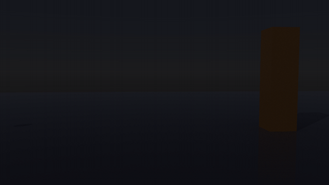

# lightwave-2020-mcp

> ### 🤖 100% prompt-built. No hand-written code.
> **Every line of code, every document, and the demo scene and render in this repository were
> produced by Claude (Anthropic's AI) from natural-language prompts.** No code was written or edited
> by a human. The demo was modeled, animated, lit and rendered by Claude driving LightWave through
> this MCP. The human side was the prompts, installing the two plug-ins, and clicking through a
> few LightWave dialog boxes.
>
> **Prompt-built is not the same as unguided.** The direction, requirements and judgment calls came
> from [Tom Bales](https://github.com/tibales1), a software architect (6 years, systems architect
> before that) with 20 years in GIS, navigation systems and game development (Unity, Unreal). The AI
> wrote it; an experienced architect steered it.

An [MCP](https://modelcontextprotocol.io) server that lets Claude (or any MCP client) drive
**LightWave 3D 2020** — Layout and Modeler — on Windows: build scenes, model, animate, render and
export FBX for Unreal or Unity.

*The demo above was built entirely through this MCP: the ball modeled in Modeler, the scene, glowing
surfaces, lights, lens flares and a 24-shard explosion keyed in Layout, then rendered.*

> **Why another LightWave MCP?** LightWave 2020's built-in Command Port receives messages but does
> not execute them, so Command-Port-based bridges (such as
> [Kartaverse/lightwave-mcp](https://github.com/Kartaverse/lightwave-mcp), which targets
> LightWave 2025.0.3+) can't control 2020. This project works around that with small
> in-app plug-ins. See [docs/ARCHITECTURE.md](docs/ARCHITECTURE.md).

## What it can do

| Area | Tools |
|---|---|
| Status / launch | `lw_status`, `launch_layout`, `launch_modeler`, `activate_layout_bridge` |
| Layout | `layout_scene_info`, `layout_get_item`, `layout_select_item`, `layout_add_item`, `layout_set_transform`, `layout_set_frame`, `layout_scene_file`, `layout_command` (any of ~840 commands), `layout_run_python` (full `lwsdk` inside Layout), `layout_export_fbx`, `layout_capture_viewport` *(experimental)*, `list_layout_commands` |
| Modeler | `modeler_command`, `modeler_state`, `modeler_run_python` (full `lwsdk` + PRIS inside Modeler), `list_modeler_commands` |
| Headless (LWSN) | `lwsn_render`, `lwsn_run_commands`, `lwsn_export_fbx` *(experimental — see Known issues)* |

## Requirements

- Windows, LightWave 3D **2020.0.x** (tested on 2020.0.3)
- Python **3.10+** (e.g. Miniconda) for the MCP server
- An MCP client — tested with the Claude desktop app

## Install

1. Put this repository at `C:\lightwave-mcp` (other locations work; the demo scene expects this one).
2. Run **`install.bat`** — creates `.venv`, installs the MCP SDK and adds a `lightwave` entry to
   `%APPDATA%\Claude\claude_desktop_config.json` (a backup is made).
3. **Layout:** *Utilities → Add Plugins* → `lightwave_bridge\lw_mcp_layout_bridge.py`, then
   *Utilities → Master Plugins* → add **Claude MCP Bridge**. LightWave restores it on later starts.
4. **Modeler:** *Utilities → Add Plugins* → `lightwave_bridge\lw_mcp_modeler_bridge.py`, then
   *Edit → Edit Keyboard Shortcuts* → select **Claude MCP Modeler Bridge** → click the **Shift-F12**
   row → *Assign* → *Done*.
5. **Fully quit** the Claude desktop app (tray icon → Quit) and reopen it.

Ask Claude to run `lw_status` — both Layout and Modeler should report as connected.

## How it works (short version)

Requests and replies are small JSON files in `%USERPROFILE%\.lightwave_mcp`.

- **Layout:** a Master plug-in installs a Windows timer that fires on Layout's main thread and
  runs waiting requests with `lwsdk.command` / Python. No Command Port needed.
- **Modeler:** modeling commands only work inside a real plug-in call, so the server briefly
  brings Modeler to the front and presses the shortcut assigned to the bridge plug-in, which then
  runs every waiting request. Missed keypresses are retried automatically.

Details, gotchas and the reasoning: [docs/ARCHITECTURE.md](docs/ARCHITECTURE.md).

## Settings

`settings.json` (read on every request): `modeler_hotkey` (default `shift+f12`).

Environment variables (in the Claude config entry, all optional): `LW_INSTALL`, `LW_CONFIG_DIR`,
`LW_CONTENT_DIR`, `LWMCP_EXCHANGE`, `LWMCP_TIMEOUT` (30 s), `LWMCP_MODELER_HOTKEY`.

The Layout/Modeler command lists are built on first use from **your** LightWave install
(`tools/build_command_cache.py`); no LightWave files are included in this repository.

## Demo: spell orb

`demo/spell` holds the scene from the GIF above (objects, `.lws`, MP4). To open it, copy the
folder to `C:\lightwave-mcp\spell` (the scene uses that content path) and load
`Scenes\spell_orb.lws`. Surface colours/glow are set by the MCP at build time and are not stored
in the LWO3 objects — see Known issues.

## Known issues

- Modeler comes to the front for a moment on each request (keyboard trigger).
- `LWSurfaceFuncs.setFlt` changes render correctly but are not saved into LWO3 objects.
- `lwsn_render` produced no frames on the test machine; render inside Layout (`RenderScene`) instead.
- `LoadScene` / `RenderScene` can open modal dialogs (content directory, save modified objects,
  render status) that pause the bridge until clicked.
- Python can't key light intensity; the demo edits the `.lws` text for light/flare envelopes.

## Tests

`python tests/test_end_to_end.py` runs the real bridge code against a mock LightWave
(fake `lwsdk` + ports) through a real MCP client session. No LightWave needed.

## License

MIT — see [LICENSE](LICENSE). LightWave is a trademark of its respective owner; this project is
not affiliated with or endorsed by LightWave Digital or NewTek.
